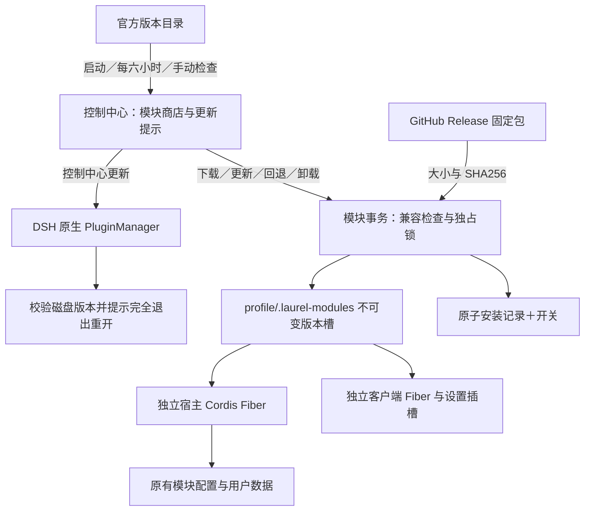

# 模块商店与独立更新

状态：1.9.2（预发布）；首批声明适配 DSH 0.2.1-rc.5，协议 `schema: 1`、`centerApi: 1`。



## 用户流程

新安装只含控制中心。打开模块列表下载，自动拉取精确版本公共库，安装后默认关闭。控制中心和已装模块分别显示版本与可用更新，常驻更新提示可打开商店。下载、应用、失败、完成与待重启均有状态；任务忙碌时拒绝变更，等待空闲再重试。后台检查只提示，不自动替用户安装代码。

模块更新暂停旧宿主 Fiber，验证并启动新代码，提交安装记录；客户端随后按新内容 hash 切换独立 Fiber。激活失败恢复旧版本。客户端和宿主不是一个跨进程原子事务，客户端激活异常会单独可见，用户可以回退或关闭模块。更新、回退仅允许相同数据格式；涉及数据迁移的版本必须另行设计，不能承诺任意降级。

卸载清除安装登记和启用开关，保留用户数据、代码槽与下载缓存；重新安装后再启用。下架只影响新下载，不自动删除本机功能。断网不影响已装功能，安装与更新需本进程成功检查目录后才开放。

控制中心通过原生安装事务更新，核对回执和磁盘版本。完成后提示完全退出 DSH（包括托盘）再重开，当前进程不谎报新版本已运行。

## 旧全量安装迁移

首次从全量版升级时使用单独迁移包。该包携带与 `.lmod` 完全相同的七模块和公共库；首次启动将代码复制到 profile 版本槽，复制旧 `laurel-center/modules.json` 开关，不改原有模块数据。迁移幂等，已登记模块不覆盖。核对成功后，后续控制中心更新使用标准精简包。不得让旧用户直接用精简包覆盖后再承诺找回被移除的内置代码。

迁移包在本地产物 `migration/laurel-center-migration-1.9.0.tgz`，标准包在根目录，二者 asset 名称可区分；发布时分别标注新安装与旧版迁移用途。自动更新目录只引用标准精简包。

## 协议与恢复

目录地址为 `https://raw.githubusercontent.com/Sakayorilove/dsh-Laurel/main/release-catalog.json`。每项声明稳定 id、目录、入口、设置 id、文案和 releases。发行版包括 version、固定 URL、sha256、bytes、hostVersions、centerApi、dataSchema、dependencies、published。只接受官方 HTTPS 源；当前协议不支持第三方源和未来 API 版本的自动兼容推断。

目录可新增模块而不更新控制中心。删除已装模块的目录项时保留其本机 metadata 和卸载入口。模块依赖精确指向隐藏公共库；相同版本的字节、大小和依赖不可改变。相同模块可有独立历史版本，控制中心版本不决定模块版本。

存储：`<profile>/.laurel-modules/installed.json` 是活动代码权威；`modules.json` 是启用权威；`slots/<uuid>/packages/` 保存独立版本及依赖；`cache/` 保存已校验下载；`catalog.json` 为离线目录；`center-receipt.json` 保存待重启回执。原子写入、进程锁和崩溃遗留锁恢复保护安装登记。失败不删除旧版本，保留上一版本回退；磁盘写失败、坏安装记录等错误停止写入并显示原因。

## 维护者发布

所有开发命令在 WSL 的源码目录执行，输出指向仓库外的新目录。仓库根的目录种子没有已发布发行版；构建输出默认 `published: false`，不会诱导下载尚不存在的资产。

```sh
pnpm run build:particle
pnpm run build:client
pnpm run build:client:check
pnpm test
python3 scripts/release-check.py --output /path/outside/repository/release-candidate
```

后续完整发布保留上一份可信目录：

```sh
node scripts/build-module-release.mjs --output /path/to/new-candidate --previous /path/to/verified-catalog.json --tag v1.8.6
```

仅改模块时，保持控制中心旧发行版，升变化模块自己的 package 版本：

```sh
node scripts/build-module-release.mjs --modules-only --output /path/to/module-candidate --previous /path/to/verified-catalog.json --tag modules-20261106
```

检查候选差异和所有产物后，另行授权上传所需资产至固定 tag；已发布的旧资产保留，不能覆盖。上传后运行只读远端校验：

```sh
node scripts/verify-release-catalog.mjs --input /path/to/candidate/release-catalog.json --output /path/to/verified-catalog.json
```

全部大小和 hash 匹配才生成 `published: true` 的新目录。最后独立发布已验证目录；切勿先把种子或未验证候选覆盖线上目录。构建和校验命令本身不执行 push、Release 或 npm 发布。`private: true` 防止误发 npm，不影响 GitHub tgz 分发。

## 参考与独立实现

- [oh-my-dsh](https://github.com/gulagala001/oh-my-dsh/tree/847fa00a9f8d41d303bc4708f08cf3648b9be0dc)：实际阅读 `version.mjs`、`version-update.mjs`、`plugin-operation.mjs`、`runtime.mjs` 和更新 UI，借鉴六小时检查、兼容范围、原生回执以及运行／磁盘版本区分。项目 MIT；本实现未复制整套代码。
- [Obsidian 官方插件发布说明](https://github.com/obsidianmd/obsidian-releases/blob/master/README.md)：借鉴目录与固定发行资产分离、明确兼容版本。
- [VS Code 官方扩展 manifest 文档](https://code.visualstudio.com/api/references/extension-manifest)：借鉴独立版本与宿主兼容声明，不引入其商店协议或执行模型。
- 实际检查 DSH rc.5 客户端加载器、Cordis 生命周期和 PluginManager 源码，并在隔离真实宿主中验证。源码存在、隔离可运行与日常桌面已启用是不同证据。

## 验收入口

`tests/module-store.test.mjs` 覆盖 HTTP 下载、依赖、坏包、忙碌、锁、恢复、迁移和目录变化；`tests/module-release.test.mjs` 覆盖版本不可变及远端发布校验。`scripts/qa-module-store.mjs` 验证真实客户端模块加载器与浏览器操作，`scripts/qa-native-store.mjs` 验证隔离原生宿主冷启和安装事务。前者 shell 插槽与 peer 受控；后者 peer 与空闲边界受控。二者均不代表用户日常桌面 GUI 已验收。
